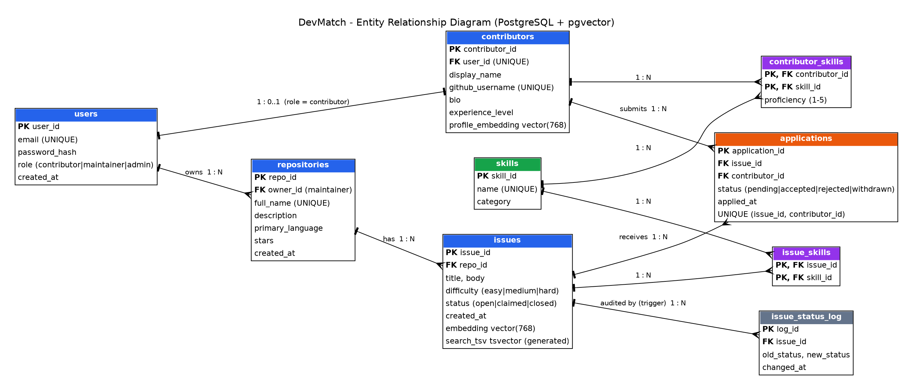

# DevMatch: ER diagram, relational schema and data dictionary

DevMatch is a semantic matcher of open-source issues to contributor skills. Maintainers publish issues, contributors get issues ranked by how well they fit their profile, and maintainers pick an applicant.

## 1. ER diagram



Source: `er_diagram.dot` (Graphviz). Re-render with `dot -Tpng docs/er_diagram.dot -o docs/er_diagram.png`.

Relationships:

| Relationship | Cardinality | Implemented by |
|---|---|---|
| user - contributor profile | 1 : 0..1 (only for role `contributor`) | `contributors.user_id` UNIQUE FK |
| maintainer (user) - repository | 1 : N | `repositories.owner_id` FK |
| repository - issue | 1 : N | `issues.repo_id` FK |
| issue - skill | M : N | junction table `issue_skills` |
| contributor - skill | M : N (with attribute `proficiency`) | junction table `contributor_skills` |
| issue - contributor | M : N (with attribute `status`) | association table `applications` |
| issue - status change | 1 : N | `issue_status_log.issue_id` FK, filled by a trigger |

## 2. Relational schema

Notation: **PK** primary key, FK foreign key, UQ unique. `ON DELETE CASCADE` on every foreign key.

```
users(user_id PK, email UQ, password_hash, role, created_at)
contributors(contributor_id PK, user_id UQ FK->users, display_name, github_username UQ,
             bio, experience_level, profile_embedding)
skills(skill_id PK, name UQ, category)
contributor_skills(contributor_id FK->contributors, skill_id FK->skills, proficiency,
                   PK(contributor_id, skill_id))
repositories(repo_id PK, owner_id FK->users, full_name UQ, description, primary_language,
             stars, created_at)
issues(issue_id PK, repo_id FK->repositories, title, body, difficulty, status, created_at,
       embedding, search_tsv)
issue_skills(issue_id FK->issues, skill_id FK->skills, PK(issue_id, skill_id))
applications(application_id PK, issue_id FK->issues, contributor_id FK->contributors,
             status, applied_at, UQ(issue_id, contributor_id))
issue_status_log(log_id PK, issue_id FK->issues, old_status, new_status, changed_at)
```

All tables are in 3NF: every non-key column depends only on the key of its table. Many-to-many links are resolved into junction tables, and skill names live once in `skills`.

## 3. Data dictionary

### users
| Column | Type | Constraint | Meaning |
|---|---|---|---|
| user_id | SERIAL | PK | Account id |
| email | TEXT | NOT NULL, UNIQUE, CHECK (regex for a valid email) | Login name |
| password_hash | TEXT | NOT NULL | bcrypt hash of the password |
| role | TEXT | NOT NULL, CHECK IN ('contributor','maintainer','admin') | Decides which pages and APIs the user may use |
| created_at | TIMESTAMPTZ | NOT NULL, DEFAULT now() | Signup time |

### contributors
| Column | Type | Constraint | Meaning |
|---|---|---|---|
| contributor_id | SERIAL | PK | Contributor profile id |
| user_id | INT | NOT NULL, UNIQUE, FK users | Owning account (1:1) |
| display_name | TEXT | NOT NULL, CHECK length 1 to 100 | Shown name |
| github_username | TEXT | NOT NULL, UNIQUE | GitHub handle |
| bio | TEXT | nullable | Free-text profile, embedded for matching |
| experience_level | TEXT | NOT NULL, DEFAULT 'beginner', CHECK IN ('beginner','intermediate','advanced') | Self-declared level |
| profile_embedding | vector(768) | nullable | Embedding of bio + skills |

### skills
| Column | Type | Constraint | Meaning |
|---|---|---|---|
| skill_id | SERIAL | PK | Skill id |
| name | TEXT | NOT NULL, UNIQUE | e.g. "TypeScript" |
| category | TEXT | NOT NULL, CHECK IN ('language','framework','database','devops','domain','other') | Grouping |

### contributor_skills
| Column | Type | Constraint | Meaning |
|---|---|---|---|
| contributor_id | INT | PK part, FK contributors | Who |
| skill_id | INT | PK part, FK skills | Which skill |
| proficiency | SMALLINT | NOT NULL, CHECK 1 to 5 | Self-rated level |

### repositories
| Column | Type | Constraint | Meaning |
|---|---|---|---|
| repo_id | SERIAL | PK | Repository id |
| owner_id | INT | NOT NULL, FK users | Maintainer who owns it |
| full_name | TEXT | NOT NULL, UNIQUE | "owner/repo" |
| description | TEXT | nullable | What the project is |
| primary_language | TEXT | nullable | Main language |
| stars | INT | NOT NULL, DEFAULT 0, CHECK >= 0 | Popularity |
| created_at | TIMESTAMPTZ | NOT NULL, DEFAULT now() | Creation time |

### issues
| Column | Type | Constraint | Meaning |
|---|---|---|---|
| issue_id | SERIAL | PK | Issue id |
| repo_id | INT | NOT NULL, FK repositories | Parent repository |
| title | TEXT | NOT NULL, CHECK length 5 to 300 | Short summary |
| body | TEXT | NOT NULL | Full description |
| difficulty | TEXT | NOT NULL, DEFAULT 'medium', CHECK IN ('easy','medium','hard') | Effort estimate |
| status | TEXT | NOT NULL, DEFAULT 'open', CHECK IN ('open','claimed','closed') | Lifecycle state |
| created_at | TIMESTAMPTZ | NOT NULL, DEFAULT now() | Creation time |
| embedding | vector(768) | nullable | Embedding of title + body + skill names |
| search_tsv | tsvector | GENERATED ALWAYS (title + body), STORED | Full-text search column |

### issue_skills
| Column | Type | Constraint | Meaning |
|---|---|---|---|
| issue_id | INT | PK part, FK issues | Issue |
| skill_id | INT | PK part, FK skills | Skill the issue needs |

### applications
| Column | Type | Constraint | Meaning |
|---|---|---|---|
| application_id | SERIAL | PK | Application id |
| issue_id | INT | NOT NULL, FK issues | Issue applied to |
| contributor_id | INT | NOT NULL, FK contributors | Applicant |
| status | TEXT | NOT NULL, DEFAULT 'pending', CHECK IN ('pending','accepted','rejected','withdrawn') | Review state |
| applied_at | TIMESTAMPTZ | NOT NULL, DEFAULT now() | Submission time |
| (table) | | UNIQUE (issue_id, contributor_id) | One application per contributor per issue |

### issue_status_log
| Column | Type | Constraint | Meaning |
|---|---|---|---|
| log_id | SERIAL | PK | Log row id |
| issue_id | INT | NOT NULL, FK issues | Issue whose status changed |
| old_status | TEXT | nullable | Status before |
| new_status | TEXT | NOT NULL | Status after |
| changed_at | TIMESTAMPTZ | NOT NULL, DEFAULT now() | When (written by trigger `trg_issue_status_log`) |

### Indexes

| Index | Table / column | Purpose |
|---|---|---|
| idx_issues_repo | issues(repo_id) | Issues of a repository |
| idx_issues_status | issues(status) | Filter open issues |
| idx_issues_tsv | issues(search_tsv), GIN | Keyword search |
| idx_issues_embedding | issues(embedding), HNSW cosine | Semantic search |
| idx_contrib_embedding | contributors(profile_embedding), HNSW cosine | Similar-profile lookups |
| idx_applications_contrib | applications(contributor_id) | A contributor's applications |

## 4. Views (db/04_views.sql)

| View | Contents |
|---|---|
| v_open_issues | Open issues with repository name, difficulty and skill list (`string_agg`) |
| v_skill_demand | Per skill: open issues needing it and contributors having it (LEFT JOINs) |
| v_repo_stats | Per repository: total, open, claimed and closed issue counts |
